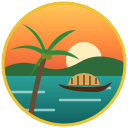

# Kerala Explorer — God's Own Country

A 3D third-person exploration game for the browser, built for Kerala Tourism.
Walk the Alleppey promenade, paddle a canoe across Vembanad Lake, watch a
Kathakali performance, greet the elephants at the Ambalappuzha temple, visit
Krishnapuram Palace and the coir village, photograph the backwater birds and
climb the old Alappuzha lighthouse — then board a
KSRTC Super Fast bus and drive the Kerala highway through all 14 districts,
together with other travellers online.



## How to play

**Online at https://starktvm-hrms.github.io/ktgame/** — the game is
published to GitHub Pages by `.github/workflows/pages.yml`, and its online
services (accounts, profiles, saved progress, multiplayer) run on Supabase
(see [supabase/README.md](supabase/README.md)). Opening `index.html`
directly also uses Supabase.

**Your own game server (optional)** — the Node.js server in `server/` offers
the same features and is built for very large player counts. It also serves
the game, and the game then uses it instead of Supabase:

```bash
cd server && npm install && npm start
```

then visit http://localhost:8080 in Chrome, Edge, Brave or Firefox, and
register with your name, a username, your mobile number and a password (tick *Remember me* to
stay signed in on that device). See [server/README.md](server/README.md)
for production deployment and scaling to lakhs of concurrent players.

**Offline** — choose *Play offline as a guest* on the sign-in screen.
Progress is then saved in the browser only.

| Action | Keyboard / mouse | Touch |
| --- | --- | --- |
| Walk | W A S D / arrows | Left joystick |
| Look / zoom | Move the mouse (the cursor is captured; Esc frees it) / wheel | Drag right side |
| Run · Jump | Shift + W · Space (run + jump = front flip) | Push the joystick all the way / Run button · Jump button |
| Talk, canoe, climb, board / leave the bus | E | E button |
| Drive the KSRTC bus | W/S throttle & brake, A/D steer, Space handbrake, H horn, V driver's view, R back on the road | Joystick |
| Profile · Players nearby · My vehicles | J · O · G | Portrait · online counter · 🚲 |
| Groups & chat · Mic on / mute | T (Enter to type in the chat bar) · B | 👥 · 🎤 in the chat bar |
| Fishing (Kochi) | E at a Fishing Point, E / Space to haul | E · Haul button |
| Camera mode (photos) | C, snap with C / Space | Eye button |
| Namaskaram · Wave | N · Q | 🙏 button |
| Map (wheel / pinch to zoom, drag to move) · First/third person | M · V | Minimap · 🎥 |
| Pause & settings | Esc | ⚙ |

## Missions

1. Welcome to God's Own Country — meet the tourism guide
2. Clean the Backwaters — collect floating plastic
3. Cheena Vala — visit the Chinese fishing nets
4. Row the Backwaters — paddle to Pathiramanal Island
5. Kathakali Evening — watch the performance
6. Temple Festival — greet the Ambalappuzha temple elephants with a Namaskaram
7. Krishnapuram Palace — find the palace and its Gajendra Moksham mural
8. Birds of the Backwaters — photograph an egret, a kingfisher and a cormorant
9. Sunset at Alappuzha Beach — reach the old lighthouse
10. Eco Hero — clean Alappuzha beach

The home map is all Alappuzha: the promenade and backwaters, the
Ambalappuzha Sri Krishna Temple, Krishnapuram Palace, the coir village in
the coconut groves, Pathiramanal Island, Kuttanad paddy fields, and the beach
with its pier and the lighthouse of 1862.
11. Grand Kerala Tour — drive the KSRTC bus through the gates of all 14 districts

Also: landmarks to discover (stars), coins along every path, XP and levels,
a photo album with downloadable postcards and an exploration certificate.

## The Kerala highway

The KSRTC bus stand in the village takes you to the highway, a road from
Thiruvananthapuram in the south to Kasaragod in the north. The road follows
the real road map of Kerala: every district centre sits at its real
position (1:20 scale, so 1 km is 50 m in the game), and the road follows the
national highways and hill roads between them (NH 66, 744, 183A, 183, 85,
544, 966 and 766) through towns such as Attingal, Adoor, Chengannur,
Adimali, Aluva, Chalakudy, Mannarkkad, Thamarassery and Taliparamba, each
with name boards and roadside shops. Thirteen branch highways are drivable
too and join the main road at junctions with direction signs: NH 744 to
Punalur, NH 183 to Kumily, NH 183A and NH 185 through the Idukki hills,
NH 85 to Munnar, NH 544 to Walayar, NH 766 to Sulthan Bathery, and the
coastal NH 66 from Kollam to Alappuzha, Cherthala to Kochi, Kochi to
Kozhikode and Kozhikode to Kannur, plus the roads south to Parassala and
north to Manjeshwar. Roads that reach the state border end at a
check-post. The big map (M) shows every road on the outline of Kerala.

Narrow **village roads** fill in the countryside: between district centres
they loop off the highway (inland, and towards the sea where there is room)
through two villages and back, with a small board at each turning, and from
the villages dead-end roads run on to hamlets. Every tourist attraction,
in every district, has its own lane from the road beside it.

Each centre has welcome gates, a bus stand, an information board,
local people to talk to, shops and a landmark, such as a temple gopuram, a
lighthouse, Chinese fishing nets, the Idukki arch dam, a hill shrine or
Bekal fort. Milestones count the kilometres, green signs point to the next
districts, and rivers are crossed on bridges. The route bar, speedometer
and minimap show where you are. Get off the bus anywhere (stop first) and
call it back at any bus stand. The Alappuzha centre has a path back to the
backwaters.

The roads are busy: cars, Kerala autorickshaws, scooters, lorries and other
KSRTC buses keep to the left, follow each other, stop for people and at red
lights, honk when blocked and overtake parked vehicles. Every district centre
has a signalled zebra crossing (jumping a red light costs a fine) and rows
of roadside shops: tea stalls, fruit stalls, bakeries, stores, textile and
medical shops, hotels and mobile shops. More shops line the highway between
towns, and the village has its own traffic through a four-way signal.

Every district centre is a **town**: about 300 m of the main road is lined
with up to three rows of two- to four-storey buildings (hotels, jewellers,
banks, textile shops, clinics, book stalls, the post office), and three side
streets lead off it, with street lamps and autos waiting at the corners.
People walk the pavements and side streets, stop to chat, wait at the
kerb and cross at the zebra crossing when the lights turn red for the
traffic. Fewer of them are out late at night, and they put up umbrellas when
it rains.
Autos, scooters and cars drive up and down the side streets (keeping left
and stopping for anyone in front of them), vehicles are parked along the
roads, and tourists stroll round every attraction.

Each district also shows its **major tourist attractions** around the
town, each with an information board (press E to read about it):

| District | Attractions |
| --- | --- |
| Thiruvananthapuram | Each on its own road (below) |
| Kollam | Thangassery Lighthouse, Jatayu Earth's Center, Ashtamudi Lake, Palaruvi Waterfalls, Thenmala Eco-tourism, Kollam Beach |
| Pathanamthitta | Sabarimala, Aranmula Snake Boats, Gavi Forest, Konni Elephant Camp, Perunthenaruvi Waterfalls |
| Alappuzha | Backwaters and houseboats, Alappuzha Beach & Lighthouse, Ambalappuzha Temple, Pathiramanal Island, Arthunkal Basilica, Kuttanad, Marari Beach |
| Kottayam | Kottayam Valiyapally, Kumarakom Bird Sanctuary, Vagamon Meadows, Ettumanoor Mahadeva Temple, Vembanad Lake, Illikkal Kallu |
| Idukki | Idukki Arch Dam, Munnar Tea Gardens, Thekkady Periyar Wildlife, Spice Plantations, Eravikulam National Park, Marayoor |
| Ernakulam | Chinese Fishing Nets, Mattancherry Palace, Kathakali Centre, St. Francis Church, Paradesi Synagogue, Cherai Beach, Marine Drive, Mangalavanam Bird Sanctuary |
| Thrissur | Vadakkunnathan Temple and elephants, Athirappilly Waterfalls, Guruvayur Temple, Kerala Kalamandalam, Punnathur Kotta, Thrissur Zoo & Museum |
| Palakkad | Palakkad Fort, Malampuzha Dam & Gardens, Silent Valley National Park, Nelliyampathy Hills, Parambikulam Tiger Reserve |
| Malappuram | Malappuram Mosque, Kottakkal Arya Vaidya Sala, a football ground, Nilambur Teak Museum, Padinharekara Beach, Kottakkunnu, Adyanpara Waterfalls |
| Kozhikode | Kappad Beach, Thusharagiri Waterfalls, Kozhikode Beach, Mananchira Square, Tali Temple, Beypore Port, Kadalundi Bird Sanctuary |
| Wayanad | Edakkal Caves, Banasura Sagar Dam, Chembra Peak, Soochipara Falls, Kuruva Island, Wayanad Wildlife Sanctuary |
| Kannur | St. Angelo Fort, Theyyam, Muzhappilangad Drive-in Beach, Arakkal Museum, Payyambalam Beach, Parassinikkadavu Snake Park |
| Kasaragod | Bekal Fort, Ananthapura Lake Temple, Chandragiri Fort, Ranipuram Hills, Kappil Beach |

Each place is modelled on what it really looks like:

- **Waterfalls:** each pours from a curved gorge of layered, wet, mossy rock
  with creepers and forest on the rim. A river runs to the lip, and the water
  curves out and spreads as it falls. White water breaks on the ledges,
  foam churns in the pool and spray clouds rise. A stream runs out past
  boulders, and there is a railed viewing deck. Each fall has its own shape:
  - Athirappilly is a broad curtain 26 m high.
  - Palaruvi is a 38 m "stream of milk", tall and narrow.
  - Perunthenaruvi is low and wide over black rock.
  - Adyanpara cascades over slabs.
  - Soochipara drops in three tiers.
  - Thusharagiri and Kallar Meenmutty fall in two.
- **Beaches:**
  - Kollam has Gandhi Park with the statue and the tetrapod breakwater.
  - At Marari, fishing boats are pulled up on the sand.
  - Muzhappilangad has cars driving on the sand.
  - Payyambalam has Kanayi's "Amma" sculpture.
  - Kappil has a cliff behind it.
  - Cherai and Ashtamudi have Chinese fishing nets.
  - Padinharekara is at a river mouth.
- **Backwaters:** Kuttanad's paddy lies below the canal between palm-lined
  bunds, with a pump house and a church. Vembanad has houseboats and a sandy
  island.
- **Hills:**
  - Illikkal Kallu has the umbrella rock, the hunchback rock and the
    Narakapalam ledge in the mist.
  - At Eravikulam, Nilgiri tahr graze below the Rajamala rock face among
    neelakurinji.
  - Chembra has its heart-shaped lake.
- **Forests:**
  - Marayoor has sandalwood forest, dolmens and a jaggery shed.
  - Parambikulam has the giant Kannimara teak, a tree house and a bamboo
    raft.
  - Thenmala has a hanging canopy bridge.
  - Gavi has a lake with kayaks.
  - Thekkady's lake has its dead tree stumps and a tour boat.
  - Silent Valley has lion-tailed macaques.
- **Kochi:** Marine Drive has the Rainbow Bridge, high-rises and the boat
  jetty. Mangalavanam's mangroves are ringed by the city.
- **Kozhikode:** Beypore has a wooden uru (dhow) on its props in scaffolding
  and the long breakwater with its light. Kadalundi has a railway bridge
  across the estuary. Mananchira is an old royal tank in a park.
- **Others:**
  - Malampuzha has the reclining Yakshi and the ropeway.
  - Banasura has islands in its reservoir.
  - Thrissur has the zoo's aviary, deer paddock and museum.
  - Parassinikkadavu has its snake pits, cobra house and crocodile pond.

The places were reworked against reference photos (openly licensed, via
Openverse) and written descriptions. Some of the changes:
- golden-brown beach sand;
- Ashtamudi's nets out in the lake;
- Jatayu in grey stone;
- Thangassery's barber-pole bands;
- Konni's log kraal;
- Munnar's contour hedges;
- Thekkady's tour boats and dead trees;
- St Francis Church's Dutch gables;
- Mattancherry's arch gate;
- Paradesi Synagogue's clock tower;
- Palakkad's granite fort and moat;
- Bekal's keyhole fort and St Angelo's triangular fort;
- Kadalundi's concrete bridge;
- Mananchira's red walk and brick pillars;
- Marine Drive's red benches and cranes;
- Kuruva's bamboo rafts;
- Ananthapura's square tank;
- Ranipuram's summit rock.

The land fits the waterfalls and dams. The ground behind each fall rises to
the height of its lip and falls away in long green slopes, with an open
valley in front. Each dam holds its reservoir at crest level in a basin of
hills, its ends set into hillsides.

Every attraction is edged with flower beds, flowering bushes, benches facing
the sight, lamps and dustbins.

Reaching an attraction for the first time discovers it (+10 coins). They
appear on the minimap, and on the big map when you zoom in.

If a vehicle gets stuck (off the road, against a wall), press **R** (or the
E button on touch screens) to put it back on the road.

## Fishing at Kochi and your own vehicles

At the Ernakulam centre, the lagoon by the Chinese fishing nets has four
Fishing Points. Cast your net, wait for the fish, and haul it in when the
marker is in the green zone. You might catch mathi (sardine), ayala
(mackerel), chemmeen (prawns), koonthal (squid), karimeen (pearl spot) or a
prized neymeen (seer fish), and every fish is worth coins.

Coins unlock vehicles in order. When your wallet reaches a vehicle's price
it unlocks and the price is paid from your coins:

| Coins | Vehicle | Top speed |
| --- | --- | --- |
| 250 | Bicycle | 45 km/h |
| 350 | Auto rickshaw (tuk tuk) | 70 km/h |
| 500 | Scooter | 90 km/h |
| 1000 | Car | 130 km/h |

Press G (or the 🚲 button) to open My Vehicles and ride one, on the
backwaters map or along the highway between districts. Other players see
you riding it.

Once a kind of vehicle is unlocked you can also ride any vehicle of that
kind you find: walk up to a parked car, an auto waiting at a town's auto
stand, or a car or auto standing still in the traffic, and press E. (Scooters
in the traffic have their riders on, so only parked scooters can be taken.)
It becomes your ride, in its own colours, in place of the one you had.

## Toddy tapping

In the coconut grove of the Coir Village, six palms are tapped: a clay pot
hangs under each crown, frothing white when it is full. Walk up to one and
press E to climb it (W up, S down, E to come down), then press E at the top
to collect the toddy. You carry it in a pot at your waist (up to four pots)
and sell it at the toddy shop (kallu shappu) beside the village path for 20
coins a pot. A tapped palm's pot fills again after a couple of minutes.
Any other coconut palm can be climbed too (E beside its trunk): at the top
you can pick a tender coconut for 3 coins.

Every other district town has its own toddy shop too, at the edge of town
with four tapped palms beside it.

Across the districts the countryside is as green as Alappuzha: thick
coconut groves with areca and banana among the palms (forest trees up in
the Ghats), open paddy fields between them, and palms, bananas, mangoes and
areca palms planted behind the buildings in town.

## Working people

Every district town is busy with people doing their jobs, each to their own
hours by the local clock:

- **Shopkeepers** stand behind their counters and serve the shoppers who stop
  in front. The tea shop's owner "pulls" tea, pouring it from a jug held high,
  while regulars sit on the bench outside with a glass: one in the morning,
  one at lunchtime, one in the evening. Shops keep their own hours (the tea
  shop opens at half past five, the textile shop at half past nine), and now
  and then a shopkeeper goes over to the tea shop for a quick tea.
- **Fruit vendors** at the market stalls call out to people passing.
- **Auto drivers** wait by their parked autos, chatting or resting in the
  seat. If you take an auto, its driver shouts after you.
- A **traffic policeman** in khaki stands at the zebra crossing (eight to
  eight), holding up a palm to stop the vehicles or waving them on.
- A **street sweeper** sweeps the footpath with a coconut-leaf broom every
  morning until eleven.
- At the bus stand the **KSRTC station master** is on duty, and people sit on
  the benches waiting for their bus at different times of day.
- **Shoppers** go from shop to shop along their side of the road.
- Every attraction has a **ticket booth** with its clerk, a **security
  guard** by day, a **night watchman** in a chair from six in the evening,
  and a **guide** who walks round the sight and stops to point it out.
- **Drivers** sit at the wheel of the autos and KSRTC buses on the roads.

The Alleppey home map has its own working people too: fruit vendors at the
promenade stalls, the tea cart's owner with regulars sipping tea beside it,
the temple priest at the shrine (morning and evening poojas) and a jasmine
seller at the gate, ticket counters at Krishnapuram Palace and the
lighthouse, a lifeguard on the beach by day, a peanut seller there in the
evening, and a sweeper on the promenade in the morning.

At the Thiruvananthapuram Zoo, three keepers go round the enclosures with
their buckets at feeding time, the mahout stays with the old tusker, a
sweeper keeps the main path clean, a snack cart in the forecourt sells tea
and ice cream, and the ticket booth at the gate has a clerk, a guard and a
night watchman. A guide walks visitors round, stopping at each enclosure.

People walk to work from home, up the side streets, when their day starts
and walk home again when it ends. A town looks different at seven in the
morning, at noon and at ten at night. Walk up to anyone and press E: they
tell you about their work and what they are doing right now.

## Groups, chat and voice

Every player picks a **username** (like `@anjali_nair`) when they register;
others use it to find and invite them. Players who signed up before
usernames existed are asked to choose one the next time they sign in.

Press **T** (or 👥) to open Groups:

- **Create** a group. A **public** group can be found and joined by anyone
  from the *Discover* tab. A **private** group is invitation only.
- **Invite** friends by username. They see the invitation under *Invites*
  (with a badge on 👥) and can accept or decline.
- **Chat**: the group screen has the full chat. While you play, the chat bar
  at the bottom shows your active group's latest messages; press Enter to
  type.
- **Play together**: the member list shows where each online member is
  (backwaters, highway district or the lighthouse). Press *Go to* to join
  them. Group friends appear as purple markers on the minimap and the map.
- **Voice**: press *Join voice* in the group (or B, or 🎤 in the chat bar)
  and allow the microphone to talk with group members who are in voice too.
  B mutes and unmutes. Audio goes directly between players (WebRTC,
  peer-to-peer) with echo cancellation. A few strict networks block direct
  connections; add a TURN server to `KT.CONFIG.turn` in `js/config.js` for
  those.

On Supabase, chat, member positions and voice signalling use Realtime
broadcast channels. With the Node server, chat is checked every few seconds
and voice is not available.

## Graphics style

The game is cel-shaded in a soft, hand-painted style: light falls in two
gentle bands, shadows are crisp, and the shade is light and cool. On Medium
and High quality, light ink lines trace the outlines and the
colours are graded warmer. Ground, roof, wood and road textures are
repainted into soft patches of colour as they load, characters have big
glossy eyes and a touch of blush, the sky is a deeper, warmer blue, and the
menus take a storybook look (warm brown panels and cream text). Choose **Classic** under Settings → Graphics style
for the earlier look (it applies the next time the game loads).

## Open world

The highway map is open: leave the road and walk or drive anywhere across
the land, over the hills and down to the beaches. The only limits are the
edges of the map: the state border to the east (with a strip beyond it),
a little way out to sea in the west, and Kerala's north and south ends.
Deep water still has to be crossed by bridge or boat.

## Malayalam radio

Press **U** to switch on the radio, and **U** again for the next station. It
plays anywhere: in the KSRTC bus, on your own vehicles or on foot. The
panel at the bottom shows the station, with previous/next, volume and
power, and the game's music fades out while the radio plays.

The stations are live internet streams of Kerala's radio. The list comes
from [Radio Browser](https://www.radio-browser.info), a free public
directory, each time the radio is first switched on, so stream addresses
stay current. Only working `https` streams are kept, with Akashvani (All
India Radio) first, then Radio Mango, Club FM, Red FM and the rest by
popularity. A station that is off the air is skipped, and a stream that
drops reconnects. HLS streams play through hls.js. The radio needs an
internet connection. The broadcasts belong to their stations: check each
station's terms before a public release.

## Fast travel

Press Y, or the compass button at the top right, or Fast travel on the big
map, to jump to the Alappuzha backwaters (home), to any of the 14 district
bus stands, or straight to a sight such as the Napier Museum or Ponmudi
Hills. At a bus stand you arrive in your KSRTC bus. At a sight you arrive on
foot, and the bus waits at the nearest bus stand.

## Thiruvananthapuram's sights

Thiruvananthapuram's sights stand at their real places, each reached by its
own road. The city is drawn larger than the map scale so they fit, and the
coast stretches with it:

- **MG Road** loops from the highway past Museum Junction (Napier Museum, the
  Zoo, Kanakakkunnu Palace), Statue Junction (the Secretariat) and East Fort
  (Sree Padmanabhaswamy Temple with the Padmatheertham tank, Kuthiramalika
  Palace, the East Fort gateway and the Meshan Mani clock, which shows the
  real time). It then runs to Shankhumugham Beach, with the mermaid
  sculpture, and to the lake at Akkulam Tourist Village before rejoining the
  highway. The main highway begins at a junction on MG Road, and NH 66 leaves
  East Fort for Neyyattinkara.
- **Akkulam Tourist Village** is a walled park behind a brick-arch gate, on
  a long backwater that winds past it, with water hyacinth along the banks.
  A red-paved promenade with stone posts, pipe rails, lamps, shade trees and
  benches runs along the river; there is a children's play tower with
  slides, the glass bridge with its yellow-draped canopy, a boat jetty, and
  lawns with crotons. People stroll the promenade and sit on the benches.
  You can climb the stair onto the glass bridge and walk out to the
  canopy, walk out along the jetty, and take a motor boat or a canoe out
  on the river (E at the boat; R takes it back to its mooring; E near the
  jetty or a bank to get out). The jetty is entered through a brick arch, and two
  flights of stone steps lead down from the promenade to the water.
- **Thiruvananthapuram Zoo** is a walled compound behind its red-brick
  gate (banded pillars, a pointed arch and a carved gable). Paths lead past
  ten landscaped enclosures: tigers by a rocky den, pool and moat; lions at
  a rock den; leopards in a forest with a branch platform; black bears with
  a cave and pool; zebras on sandy ground; an elephant and her calf with a
  mud wallow and shelter; orangutans (one carrying a baby) on a climbing
  frame; lion-tailed macaques among bamboo; adjutant storks and egrets in a
  wetland; and spotted deer behind a wire mesh. Monkeys and peacocks roam
  the lawns, and the animals walk their enclosures. Visitors (families,
  couples and a school group) walk in at the gate, stop at the railings to
  watch and wave, and walk on; others rest on the benches. The big
  animals are built with shaped bodies, jointed legs and painted coats
  (stripes, rosettes, spots), with detailed heads, manes and antlers.
- **Ponmudi Road** climbs past Koyikkal Palace at Nedumangad and the Kallar
  Meenmutty falls to the misty top of Ponmudi Hills, the "mini Munnar":
  rolling grassland dotted with dark boulders and shola trees in the hollows,
  with low mist drifting by. From the car park, where the Nilgiri tahr pair
  stand on their rock cairn, a dirt trail winds up a steep grassy peak to
  the telecom station on top; visitors walk it and take photographs. A side
  road runs to Aruvikkara Dam.
- A short road from Attingal leads to the jetty for Ponnumthuruthu Island
  and its temple.

The Sree Padmanabhaswamy Temple stands in a walled compound reached by its own street. Like the Secretariat, it is modelled on photos.
- **The gopuram:** the great east gopuram has seven tiers of cream-gold carved figures under a barrel roof with seven golden kalasams. It stands on a white base with a pillared, arched entrance, and a flight of steps runs between brass lamp towers.
- **The streets:** a street of four nadas runs round the compound. The East Nada leads in from the road, lined with shops selling brass lamps, flowers and garlands, puja items, sweets, books and bangles, with shopkeepers at their counters and three-globe street lamps.
- **The way in:** climb the steps, pass through the porch of carved granite pillars under the white studded arch, and walk straight through the gopuram into the temple. The doors stand open.
- **Inside the temple:**
  - **The corridor:** the sreebali pura runs round the inner courtyard. It is a long corridor of carved granite pillars, many carrying a lamp-bearing deepalakshmi, with brass lamps hanging under the stone ceiling.
  - **The flagstaff:** the golden flagstaff stands with the stone altar in front of the corridor.
  - **The sanctum:** in the courtyard stand the granite sanctum under its golden roofs and the ottakkal mandapam. Climb onto the mandapam and look through the three doors: the god reclines on the coiled serpent Anantha, with the five hoods over his head, the lotus rising from his navel and oil lamps burning before him.
- **Kuthiramalika Palace:** the palace stands beside the tank, along its west side, facing the water. It is a long two-storey palace in the Kerala style: white below with a verandah of wooden pillars, dark carved wooden screens above, steep tiled roofs with gables, and a taller middle block. A row of carved wooden horses under its eaves gives it its name, "the mansion of horses".
- **The Padmatheertham tank:** a great tank sunk into the ground, with nine rings of stone steps on every side going down to the water. You can walk down to the water's edge.
  - Its yellow-pillared mandapam stands on a plinth down on the steps.
  - A stone colonnade and white Kerala houses with tiled roofs line its banks, all inside its own walled compound with a gate.
- **The people:** devotees in mundu and saree walk up to the gopuram, round the nadas and to the tank, stopping to pray.

Shankhumugham Beach is a wide stretch of golden sand.
- **The mermaid:** the Jalakanyaka, a 35 m grey concrete mermaid, lies back in a great open scallop shell.
- **The beach:** an old pillared stone mandapam stands on the sand, painted fishing boats are drawn up (one under a blue tarpaulin), and lamps and palms line the back of the beach.
- **The people:** families stand, sit and walk along the water's edge as at sunset.

The Secretariat is a large compound modelled on photos.
- **The building:** a long two-storey white building with arched verandahs below and balustraded ones above. Green bamboo blinds screen both floors, and the roof is low and red.
- **The centre:** a portico of six tall columns under a pediment, and the clock tower with a white dome, a golden finial and the national flag. Wings with porticos of their own stand at both ends.
- **The grounds:** inside white walls and iron railings there is a drive with a tiered fountain, lawns with yellow-green hedges and white fences, marigolds in clay pots, flower beds, topiary, palms and lamps. The statue of Velu Thampi Dalawa stands on its tall dark plinth, and a red-paved footpath runs outside the wall.

The Arabian Sea lies along the whole coast. Beaches are only where the land
meets the sea.

## Alappuzha lighthouse

The Alappuzha lighthouse, built in 1862, stands by the beach and its old
pier. Press E at its door to go inside: read the exhibits about its history
and the great Fresnel lens, ring the ship's bell, and talk to Abdul the
keeper. Then take the spiral stairs up to the gallery at the top for the
view over the Arabian Sea.

## Live time and weather

At night every road is lit: the poles along the highways, branch roads
and village roads carry street lights that come on at dusk and throw pools
of light on the road, and the lamp posts in the towns and parks glow over
the paths.

The sky follows the clock on your device: sunrise, golden hour, sunset, a
starry night with the moon, the lighthouse beam sweeping in the dark,
glowing lamps and crickets after dark. The weather is the real current
weather where you are in the game: Alappuzha on the backwaters map, the
nearest district on the highway. It comes from [Open-Meteo](https://open-meteo.com)
(free, no key) and is refreshed every 15 minutes, so you'll see clouds, rain,
mist and monsoon thunderstorms with lightning when they really happen. If the
weather can't be fetched, a believable stand-in is used (wetter in the
monsoon months). The chip at the top right shows the time and weather; click
it for details. Pause → Settings → *Time & weather* can switch to clear skies
or to an always sunny day.

## Project layout

```
index.html            entry point
css/style.css         HUD and menus
lib/three.min.js      three.js r149 (MIT, vendored — no CDN needed)
lib/hls.min.js        hls.js 1.5.17 (Apache-2.0, vendored) for HLS radio streams, loaded on demand
js/                   game code (terrain, world, highway, vehicle, entities, player,
                      missions, UI, audio, net = multiplayer client, account = sign-in & profiles,
                      groups = groups & chat, voice = WebRTC voice chat,
                      lighthouse = Alappuzha lighthouse interior, sky = time of day & weather,
                      destinations = sights on their own roads (Thiruvananthapuram),
                      toon = cel-shaded lighting, ink outlines and colour grade,
                      radio = Malayalam internet radio,
                      townfolk = people, tourists and street traffic in the district towns,
                      life = working people with daily routines, and the drivers in traffic)
server/               Node.js game server (accounts, progress, profiles, real-time play)
supabase/             Supabase backend: database migration and the `api` Edge Function
lib/supabase.min.js   supabase-js 2.117.3 (MIT, vendored) for Supabase Realtime
assets/models/        procedural 3D model library: characters, animals, boats,
                      buildings (Kerala houses, temple, church, lighthouse...),
                      trees & plants, props
assets/textures/      generated textures (.jpg/.png) + textures.js bundle
assets/icons/         logo and favicon
tools/generate_textures.py   regenerates every texture
```

All art is original and generated by code: textures are painted by
`tools/generate_textures.py` (Python 3 + Pillow + NumPy) and bundled into
`assets/textures/textures.js` as data URIs, so the game also runs from
`file://`. 3D models are built procedurally in `assets/models/`. Music and
sound effects are synthesised live with the Web Audio API.

```bash
python3 tools/generate_textures.py
```

## Graphics settings

Pause → Settings → Graphics quality (Low / Medium / High) controls shadows,
resolution and terrain detail. Lower it on older laptops or phones.

On Medium and High, the live sky is turned into an environment map that
lights and reflects off every surface (it follows the time of day and the
weather). Everywhere: the ground blends grass with patches of bare earth and
red laterite on slopes, with close-up detail; the highway has worn asphalt
with tyre tracks and cracks, black-and-white kerbs and reflectors that glow
at night; town footpaths are paver blocks; dense grass, flowers and ferns
grow around you, with areca palms, jackfruit trees and forest on the ghats;
people up close are drawn in full detail, many men wear a moustache, women
jasmine in their hair, and people carry shopping bags, handbags and phones.
