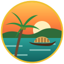

# Kerala Explorer — God's Own Country

A 3D third-person exploration game for the browser, built for Kerala Tourism.
Walk the Alleppey promenade, paddle a canoe across Vembanad Lake, watch a
Kathakali performance, greet the elephants at the Ambalappuzha temple, visit
Krishnapuram Palace and the coir village, photograph the backwater birds and
climb the old Alappuzha lighthouse — then board a
KSRTC Super Fast bus and drive the Kerala highway through all 14 districts,
together with other travellers online.



## Loading and sign-in

The game opens on one card, **Kerala Saavari**: a wooden name plaque with
a coconut palm and a houseboat riding a wave, on gold-trimmed dark wood.
The golden loading bar and the log in / register form are on the card
together, so players can sign in (or choose to play as a guest) while the
world builds. Behind it a painted backwater is animated: clouds drift,
houseboats glide by and the water shimmers; when the world is ready it
fades into the live 3D backwaters. Anyone who signs in early sees a
welcome and the bar, and goes on to the character creator as soon as the
world is ready. A remembered player goes straight on.

## Picking up where you left off

Continue puts you back at the exact spot where you left the game, facing the
same way:

- **On the highway**: on foot where you stood, or back at the wheel of the
  vehicle you were in, where it stood: the KSRTC bus, or your own ride with
  the same paint. If you were up on a platform, a bridge or the Thampanoor
  skywalk, you come back up on it.
- **Inside the Kovalam or Thangassery lighthouse**: just outside its door.
- **In the home village**: where you last walked.

The spot is saved every 20 seconds and whenever the page is closed or
hidden.

## Game modes

After signing in you choose how to play:

- **Story Mode**: *Save Kerala's Legacy*, a 12-chapter campaign (about four
  hours) from Bekal in the north to Thiruvananthapuram in the south.
- **Free Roam**: the open game as before, all 14 districts with buses,
  festivals and the free-roam missions.
- **Online PVP**: coming soon.

### Story Mode

The Shadow Collective wants to turn Kerala into a commercial tourism
empire, and is hunting the **Heart of Kerala**: seven ancient symbols
(Nature, Heritage, Wildlife, Tradition, Culture, Adventure, Unity). With
**Appuppan** (the guide), **Meera** (the companion) and the people met
along the way, you follow an old explorer's journal to find the symbols
before **the Collector** does.

| # | Destination | Chapter | Symbol |
|---|---|---|---|
| 01 | Kasaragod – Bekal | The Mysterious Discovery | Nature |
| 02 | Kannur | The Secret of Theyyam | Heritage |
| 03 | Wayanad | The Forest Mystery | Wildlife |
| 04 | Kozhikode | The Lost Trading Route | Tradition |
| 05 | Thrissur | The Festival Mystery | Culture |
| 06 | Kochi | The Stolen Artefact | Adventure |
| 07 | Athirappilly | The Waterfall Mission | |
| 08 | Munnar | The Secret of the Mountains | |
| 09 | Thekkady – Periyar | The Wildlife Rescue | |
| 10 | Alappuzha – Kumarakom | The Great Backwater Challenge | |
| 11 | Varkala – Kovalam | The Coastal Mystery | |
| 12 | Thiruvananthapuram | The Heart of Kerala | Unity |

Conversations are filmed like a storyboard: the speakers turn to face each
other and the camera cuts on every line, from an establishing wide shot to
reverse shots over the listener's shoulder, close-ups on questions and
exclamations, and two-shots, always from one side of the line between
them and clear of walls, with cinema bars and the line as a subtitle.
Each character speaks with a voice of their own (the browser's built-in
speech: Appuppan low and slow, Meera brighter, the Collector deep), and
the speaker's head nods along with every word.
Lines move on when the voice finishes; Next skips ahead and the speaker
button turns the voices off. Where speech is not available the mouth
keeps time with the words.

Chapters unlock one after another on the campaign map (K, or the 📖
button), which also shows the symbols found, badges and travel points, and
the journal (the story so far). Each chapter takes you to its places and
plays its missions: conversations, a movement tutorial, searches for clues,
chases on foot, vehicle chases (a scooter after the getaway car in Fort
Kochi, a car after the dumping truck at Athirappilly, the escape by jeep
down the Munnar road, the final car chase in Thiruvananthapuram), timed
runs, photography, press-to-use tasks (disable
traps, clear drains, plant saplings), symbol puzzles, quizzes (Theyyam
craft, spices, Kochi's history) and a rhythm game (the chenda melam and
the snake-boat race). Finishing the campaign earns the title *Guardian of
God's Own Country*, 1,000 bonus points and the Legendary Explorer outfit.
The chapters are data (`js/story-data.js`) played by the engine in
`js/story.js`, so the story can be rewritten without touching the code.

## Screen layout

Every screen shares the painted wood-and-gold look of the title card:
dark wood panels with gold borders, chunky yellow buttons and rounded
lettering, in the HUD, the dialogue box and every menu (pause, map, fast
travel, profile, vehicles, groups, photo album).

The HUD keeps status along the top and controls along the bottom: your
portrait, name and level top-left with the current mission under them,
the compass top-centre, the time, coins, stars, eco leaves, players
online and the menu buttons top-right; the minimap bottom-right with the
action buttons beside it, and, when you drive, the route bar and
speedometer along the bottom middle. Phones and tablets get the touch
layout from the first frame (joystick bottom-left, run and jump buttons
bottom-right, the route bar tucked under the compass), and on a phone held
upright the mission folds to its title (tap to open), the minimap sits
beside it under the compass, and the route bar, speedometer, prompts and
radio stack above the controls. During a conversation on a small screen
the HUD steps aside so the dialogue box has the room.

## How to play

**Online at https://starktvm-hrms.github.io/ktgame/** — the game is
published to GitHub Pages by `.github/workflows/pages.yml`, and its online
services (accounts, profiles, saved progress, multiplayer) run on Supabase
(see [supabase/README.md](supabase/README.md)). Opening `index.html`
directly also uses Supabase.

**Your own game server (optional)** — the Node.js server in `server/` offers
the same features and is built for very large player counts. It also serves
the game, and the game then uses it instead of Supabase:

```bash
cd server && npm install && npm start
```

then visit http://localhost:8080 in Chrome, Edge, Brave or Firefox, and
register with your name, a username, your mobile number and a password (tick *Remember me* to
stay signed in on that device). See [server/README.md](server/README.md)
for production deployment and scaling to lakhs of concurrent players.

**Offline** — choose *Play offline as a guest* on the sign-in screen.
Progress is then saved in the browser only.

| Action | Keyboard / mouse | Touch |
| --- | --- | --- |
| Walk | W A S D / arrows | Left joystick |
| Look / zoom | Move the mouse (the cursor is captured; Esc frees it) / wheel | Drag right side |
| Run · Jump | Shift + W · Space (run + jump = front flip) | Push the joystick all the way / Run button · Jump button |
| Talk, canoe, climb, board / leave the bus | E | E button |
| Drive the KSRTC bus | W/S throttle & brake, A/D steer, Space handbrake, H horn, V driver's view, R back on the road | Joystick |
| Profile · Players nearby · My vehicles | J · O · G | Portrait · online counter · 🚲 |
| Groups & chat · Mic on / mute | T (Enter to type in the chat bar) · B | 👥 · 🎤 in the chat bar |
| Fishing (Kochi) | E at a Fishing Point, E / Space to haul | E · Haul button |
| Camera mode (photos) | C, snap with C / Space | Eye button |
| Namaskaram · Wave | N · Q | 🙏 button |
| Map (wheel / pinch to zoom, drag to move) · First/third person | M · V | Minimap · 🎥 |
| Pause & settings | Esc | ⚙ |

## Missions

1. Welcome to God's Own Country — meet the tourism guide
2. Clean the Backwaters — collect floating plastic
3. Cheena Vala — visit the Chinese fishing nets
4. Row the Backwaters — paddle to Pathiramanal Island
5. Kathakali Evening — watch the performance
6. Temple Festival — greet the Ambalappuzha temple elephants with a Namaskaram
7. Krishnapuram Palace — find the palace and its Gajendra Moksham mural
8. Birds of the Backwaters — photograph an egret, a kingfisher and a cormorant
9. Sunset at Alappuzha Beach — reach the old lighthouse
10. Eco Hero — clean Alappuzha beach

The home map is all Alappuzha: the promenade and backwaters, the
Ambalappuzha Sri Krishna Temple, Krishnapuram Palace, the coir village in
the coconut groves, Pathiramanal Island, Kuttanad paddy fields, and the beach
with its pier and the lighthouse of 1862.
11. Grand Kerala Tour — drive the KSRTC bus through the gates of all 14 districts

Also: landmarks to discover (stars), coins along every path, XP and levels,
a photo album with downloadable postcards and an exploration certificate.

## The Kerala highway

The KSRTC bus stand in the village takes you to the highway, a road from
Thiruvananthapuram in the south to Kasaragod in the north. The road follows
the real road map of Kerala: every district centre sits at its real
position (1:20 scale, so 1 km is 50 m in the game), and the road follows the
national highways and hill roads between them (NH 66, 744, 183A, 183, 85,
544, 966 and 766) through towns such as Attingal, Adoor, Chengannur,
Adimali, Aluva, Chalakudy, Mannarkkad, Thamarassery and Taliparamba, each
with name boards and roadside shops. Thirteen branch highways are drivable
too and join the main road at junctions with direction signs: NH 744 to
Punalur, NH 183 to Kumily, NH 183A and NH 185 through the Idukki hills,
NH 85 to Munnar, NH 544 to Walayar, NH 766 to Sulthan Bathery, and the
coastal NH 66 from Kollam to Alappuzha, Cherthala to Kochi, Kochi to
Kozhikode and Kozhikode to Kannur, plus the roads south to Parassala and
north to Manjeshwar. Roads that reach the state border end at a
check-post. The big map (M) shows every road on the outline of Kerala.

Narrow **village roads** fill in the countryside: between district centres
they loop off the highway (inland, and towards the sea where there is room)
through two villages and back, with a small board at each turning, and from
the villages dead-end roads run on to hamlets. Every tourist attraction,
in every district, has its own lane from the road beside it.

Each centre has welcome gates, a bus stand, an information board,
local people to talk to, shops and a landmark, such as a temple gopuram, a
lighthouse, Chinese fishing nets, the Idukki arch dam, a hill shrine or
Bekal fort. Milestones count the kilometres, green signs point to the next
districts, and rivers are crossed on bridges. The route bar, speedometer
and minimap show where you are. Get off the bus anywhere (stop first) and
call it back at any bus stand. The Alappuzha centre has a path back to the
backwaters.

The roads are busy: cars, Kerala autorickshaws, scooters, lorries and other
KSRTC buses keep to the left, follow each other, stop for people and at red
lights, honk when blocked and overtake parked vehicles. Every district centre
has a signalled zebra crossing (jumping a red light costs a fine) and rows
of roadside shops: tea stalls, fruit stalls, bakeries, stores, textile and
medical shops, hotels and mobile shops. More shops line the highway between
towns, and the village has its own traffic through a four-way signal.

Every district centre is a **town**: about 300 m of the main road is lined
with up to three rows of two- to four-storey buildings (hotels, jewellers,
banks, textile shops, clinics, book stalls, the post office), and three side
streets lead off it, with street lamps and autos waiting at the corners.
People walk the pavements and side streets, stop to chat, wait at the
kerb and cross at the zebra crossing when the lights turn red for the
traffic. Fewer of them are out late at night, and they put up umbrellas when
it rains.
Autos, scooters and cars drive up and down the side streets (keeping left
and stopping for anyone in front of them), vehicles are parked along the
roads, and tourists stroll round every attraction.

Each district also shows its **major tourist attractions** around the
town, each with an information board (press E to read about it):

| District | Attractions |
| --- | --- |
| Thiruvananthapuram | Each on its own road (below) |
| Kollam | Thangassery Lighthouse, Jatayu Earth's Center, Ashtamudi Lake, Palaruvi Waterfalls, Thenmala Eco-tourism, Kollam Beach |
| Pathanamthitta | Sabarimala, Aranmula Snake Boats, Gavi Forest, Konni Elephant Camp, Perunthenaruvi Waterfalls |
| Alappuzha | Backwaters and houseboats, Alappuzha Beach & Lighthouse, Ambalappuzha Temple, Pathiramanal Island, Arthunkal Basilica, Kuttanad, Marari Beach |
| Kottayam | Kottayam Valiyapally, Kumarakom Bird Sanctuary, Vagamon Meadows, Ettumanoor Mahadeva Temple, Vembanad Lake, Illikkal Kallu |
| Idukki | Idukki Arch Dam, Munnar Tea Gardens, Thekkady Periyar Wildlife, Spice Plantations, Eravikulam National Park, Marayoor |
| Ernakulam | Chinese Fishing Nets, Mattancherry Palace, Kathakali Centre, St. Francis Church, Paradesi Synagogue, Cherai Beach, Marine Drive, Mangalavanam Bird Sanctuary |
| Thrissur | Vadakkunnathan Temple and elephants, Athirappilly Waterfalls, Guruvayur Temple, Kerala Kalamandalam, Punnathur Kotta, Thrissur Zoo & Museum |
| Palakkad | Palakkad Fort, Malampuzha Dam & Gardens, Silent Valley National Park, Nelliyampathy Hills, Parambikulam Tiger Reserve |
| Malappuram | Malappuram Mosque, Kottakkal Arya Vaidya Sala, a football ground, Nilambur Teak Museum, Padinharekara Beach, Kottakkunnu, Adyanpara Waterfalls |
| Kozhikode | Kappad Beach, Thusharagiri Waterfalls, Kozhikode Beach, Mananchira Square, Tali Temple, Beypore Port, Kadalundi Bird Sanctuary |
| Wayanad | Edakkal Caves, Banasura Sagar Dam, Chembra Peak, Soochipara Falls, Kuruva Island, Wayanad Wildlife Sanctuary |
| Kannur | St. Angelo Fort, Theyyam, Muzhappilangad Drive-in Beach, Arakkal Museum, Payyambalam Beach, Parassinikkadavu Snake Park |
| Kasaragod | Bekal Fort, Ananthapura Lake Temple, Chandragiri Fort, Ranipuram Hills, Kappil Beach |

Each place is modelled on what it really looks like:

- **Waterfalls:** each pours from a curved gorge of layered, wet, mossy rock
  with creepers and forest on the rim. A river runs to the lip, and the water
  curves out and spreads as it falls. White water breaks on the ledges,
  foam churns in the pool and spray clouds rise. A stream runs out past
  boulders, and there is a railed viewing deck. Each fall has its own shape:
  - Athirappilly is a broad curtain 26 m high.
  - Palaruvi is a 38 m "stream of milk", tall and narrow.
  - Perunthenaruvi is low and wide over black rock.
  - Adyanpara cascades over slabs.
  - Soochipara drops in three tiers.
  - Thusharagiri and Kallar Meenmutty fall in two.
- **Beaches:**
  - Kollam has Gandhi Park with the statue and the tetrapod breakwater.
  - At Marari, fishing boats are pulled up on the sand.
  - Muzhappilangad has cars driving on the sand.
  - Payyambalam has Kanayi's "Amma" sculpture.
  - Kappil has a cliff behind it.
  - Cherai and Ashtamudi have Chinese fishing nets.
  - Padinharekara is at a river mouth.
- **Backwaters:** Kuttanad's paddy lies below the canal between palm-lined
  bunds, with a pump house and a church. Vembanad has houseboats and a sandy
  island.
- **Hills:**
  - Illikkal Kallu has the umbrella rock, the hunchback rock and the
    Narakapalam ledge in the mist.
  - At Eravikulam, Nilgiri tahr graze below the Rajamala rock face among
    neelakurinji.
  - Chembra has its heart-shaped lake.
- **Forests:**
  - Marayoor has sandalwood forest, dolmens and a jaggery shed.
  - Parambikulam has the giant Kannimara teak, a tree house and a bamboo
    raft.
  - Thenmala has a hanging canopy bridge.
  - Gavi has a lake with kayaks.
  - Thekkady's lake has its dead tree stumps and a tour boat.
  - Silent Valley has lion-tailed macaques.
- **Kochi:** Marine Drive has the Rainbow Bridge, high-rises and the boat
  jetty. Mangalavanam's mangroves are ringed by the city.
- **Kozhikode:** Beypore has a wooden uru (dhow) on its props in scaffolding
  and the long breakwater with its light. Kadalundi has a railway bridge
  across the estuary. Mananchira is an old royal tank in a park.
- **Others:**
  - Malampuzha has the reclining Yakshi and the ropeway.
  - Banasura has islands in its reservoir.
  - Thrissur has the zoo's aviary, deer paddock and museum.
  - Parassinikkadavu has its snake pits, cobra house and crocodile pond.

The places were reworked against reference photos (openly licensed, via
Openverse) and written descriptions. Some of the changes:
- golden-brown beach sand;
- Ashtamudi's nets out in the lake;
- Jatayu in grey stone;
- Thangassery's barber-pole bands;
- Konni's log kraal;
- Munnar's contour hedges;
- Thekkady's tour boats and dead trees;
- St Francis Church's Dutch gables;
- Mattancherry's arch gate;
- Paradesi Synagogue's clock tower;
- Palakkad's granite fort and moat;
- Bekal's keyhole fort and St Angelo's triangular fort;
- Kadalundi's concrete bridge;
- Mananchira's red walk and brick pillars;
- Marine Drive's red benches and cranes;
- Kuruva's bamboo rafts;
- Ananthapura's square tank;
- Ranipuram's summit rock.

The land fits the waterfalls and dams. The ground behind each fall rises to
the height of its lip and falls away in long green slopes, with an open
valley in front. Each dam holds its reservoir at crest level in a basin of
hills, its ends set into hillsides.

Every attraction is edged with flower beds, flowering bushes, benches facing
the sight, lamps and dustbins.

Reaching an attraction for the first time discovers it (+10 coins). They
appear on the minimap, and on the big map when you zoom in.

If a vehicle gets stuck (off the road, against a wall), press **R** (or the
E button on touch screens) to put it back on the road.

## Fishing at Kochi and your own vehicles

At the Ernakulam centre, the lagoon by the Chinese fishing nets has four
Fishing Points. Cast your net, wait for the fish, and haul it in when the
marker is in the green zone. You might catch mathi (sardine), ayala
(mackerel), chemmeen (prawns), koonthal (squid), karimeen (pearl spot) or a
prized neymeen (seer fish), and every fish is worth coins.

Coins unlock vehicles in order. When your wallet reaches a vehicle's price
it unlocks and the price is paid from your coins:

| Coins | Vehicle | Top speed |
| --- | --- | --- |
| 250 | Bicycle | 45 km/h |
| 350 | Auto rickshaw (tuk tuk) | 70 km/h |
| 500 | Scooter | 90 km/h |
| 1000 | Car | 130 km/h |

Press G (or the 🚲 button) to open My Vehicles and ride one, on the
backwaters map or along the highway between districts. Other players see
you riding it.

Once a kind of vehicle is unlocked you can also ride any vehicle of that
kind you find: walk up to a parked car, an auto waiting at a town's auto
stand, or a car or auto standing still in the traffic, and press E. (Scooters
in the traffic have their riders on, so only parked scooters can be taken.)
It becomes your ride, in its own colours, in place of the one you had.

## Toddy tapping

In the coconut grove of the Coir Village, six palms are tapped: a clay pot
hangs under each crown, frothing white when it is full. Walk up to one and
press E to climb it (W up, S down, E to come down), then press E at the top
to collect the toddy. You carry it in a pot at your waist (up to four pots)
and sell it at the toddy shop (kallu shappu) beside the village path for 20
coins a pot. A tapped palm's pot fills again after a couple of minutes.
Any other coconut palm can be climbed too (E beside its trunk): at the top
you can pick a tender coconut for 3 coins.

Every other district town has its own toddy shop too, at the edge of town
with four tapped palms beside it.

Across the districts the countryside is as green as Alappuzha: thick
coconut groves with areca and banana among the palms (forest trees up in
the Ghats), open paddy fields between them, and palms, bananas, mangoes and
areca palms planted behind the buildings in town.

## Working people

Every district town is busy with people doing their jobs, each to their own
hours by the local clock:

- **Shopkeepers** stand behind their counters and serve the shoppers who stop
  in front. The tea shop's owner "pulls" tea, pouring it from a jug held high,
  while regulars sit on the bench outside with a glass: one in the morning,
  one at lunchtime, one in the evening. Shops keep their own hours (the tea
  shop opens at half past five, the textile shop at half past nine), and now
  and then a shopkeeper goes over to the tea shop for a quick tea.
- **Fruit vendors** at the market stalls call out to people passing.
- **Auto drivers** wait by their parked autos, chatting or resting in the
  seat. If you take an auto, its driver shouts after you.
- A **traffic policeman** in the Kerala traffic police uniform (white
  half-sleeve shirt with shoulder straps, name plate and lanyard, khaki
  trousers, black belt and shoes, white peaked cap with a black band) stands
  at the zebra crossing (eight to eight), holding up a palm to stop the
  vehicles or waving them on.
- A **street sweeper** sweeps the footpath with a coconut-leaf broom every
  morning until eleven.
- At the bus stand the **KSRTC station master** is on duty, and people sit on
  the benches waiting for their bus at different times of day.
- **Shoppers** go from shop to shop along their side of the road.
- Every attraction has a **ticket booth** with its clerk, a **security
  guard** by day, a **night watchman** in a chair from six in the evening,
  and a **guide** who walks round the sight and stops to point it out.
- **Drivers** sit at the wheel of the autos and KSRTC buses on the roads.

The Alleppey home map has its own working people too: fruit vendors at the
promenade stalls, the tea cart's owner with regulars sipping tea beside it,
the temple priest at the shrine (morning and evening poojas) and a jasmine
seller at the gate, ticket counters at Krishnapuram Palace and the
lighthouse, a lifeguard on the beach by day, a peanut seller there in the
evening, and a sweeper on the promenade in the morning.

At the Thiruvananthapuram Zoo, three keepers go round the enclosures with
their buckets at feeding time, the mahout stays with the old tusker, a
sweeper keeps the main path clean, a snack cart in the forecourt sells tea
and ice cream, and the ticket booth at the gate has a clerk, a guard and a
night watchman. A guide walks visitors round, stopping at each enclosure.

People walk to work from home, up the side streets, when their day starts
and walk home again when it ends. A town looks different at seven in the
morning, at noon and at ten at night. Walk up to anyone and press E: they
tell you about their work and what they are doing right now.

## Groups, chat and voice

Every player picks a **username** (like `@anjali_nair`) when they register;
others use it to find and invite them. Players who signed up before
usernames existed are asked to choose one the next time they sign in.

Press **T** (or 👥) to open Groups:

- **Create** a group. A **public** group can be found and joined by anyone
  from the *Discover* tab. A **private** group is invitation only.
- **Invite** friends by username. They see the invitation under *Invites*
  (with a badge on 👥) and can accept or decline.
- **Chat**: the group screen has the full chat. While you play, the chat bar
  at the bottom shows your active group's latest messages; press Enter to
  type.
- **Play together**: the member list shows where each online member is
  (backwaters, highway district or the lighthouse). Press *Go to* to join
  them. Group friends appear as purple markers on the minimap and the map.
- **Voice**: press *Join voice* in the group (or B, or 🎤 in the chat bar)
  and allow the microphone to talk with group members who are in voice too.
  B mutes and unmutes. Audio goes directly between players (WebRTC,
  peer-to-peer) with echo cancellation. A few strict networks block direct
  connections; add a TURN server to `KT.CONFIG.turn` in `js/config.js` for
  those.

On Supabase, chat, member positions and voice signalling use Realtime
broadcast channels. With the Node server, chat is checked every few seconds
and voice is not available.

## Graphics style

Settings → Graphics style offers three looks (each applies the next time the
game loads):

- **Realistic** (the default): physically based light with deep, soft shade.
  On Medium and High the frame goes through a camera-like finish:
  - ambient occlusion darkens corners, the ground along walls, under eaves,
    vehicles and flyovers;
  - on High, bloom lets lamps, headlights and the sun's glints bleed light;
  - a colour grade warms the light, cools the shade and adds a vignette.

  Plaster, concrete, roof tiles, laterite and asphalt carry the bumps and
  roughness of real photo scans (Poly Haven, CC0), matched to the colour
  photos they already use. Town buildings are weathered by the monsoon:
  - rain streaks below parapets and sills, and damp, splashed wall feet;
  - concrete sunshades over each row of windows, and balconies on some;
  - window grilles, air-conditioner boxes, and open shops with stocked shelves.

  The main road through each district town has cement forecourts up to the
  shopfronts, dusty trodden ground between buildings, and KSEB concrete poles
  strung with sagging overhead lines. High quality also doubles the
  sun's shadow resolution.
- **Cel-shaded**: a soft, hand-painted style. Light falls in two gentle
  bands, shadows are crisp and the shade is light and cool. On Medium and
  High, light ink lines trace the outlines and the colours are graded warmer.
  Photo textures are repainted into soft patches of colour, characters have
  big glossy eyes, the sky is a deeper blue, and the menus take a storybook
  look.
- **Classic**: the earliest look.

### A connected road network

The roads join up into one network, as in an open-world city game: you can
always drive through.

- A street or village road that stopped at its hamlet, and the highway's
  short stubs, now run on to the nearest other road along a new village
  road.
- Roads to sights (Ponmudi, Aruvikkara, Varkala, Kovalam) keep their road
  end at the sight, and a village road branches off just before it, back to
  the network.
- In Thiruvananthapuram, a **Ring Road** runs round the east of the city from
  NH 66 to the Ponmudi road. A grid of about 60 city streets, 110 m apart and
  lined up with MG Road, fills the localities between it, MG Road and the
  beach road. The streets meet each other and the roads at junctions; none
  crosses another. Every piece joins roads at both ends, and any piece left
  hanging is removed.
- What is left open: the roads out to the state borders, one coastal lane,
  and the highway's very end at the sea.

### The railway

Kerala's railway runs across the map, after the Kerala railway map (js/rail.js):

- **Lines**, double track on the main lines and single track on the branches:
  - Thiruvananthapuram Central – Kollam – Kayamkulam;
  - from Kayamkulam to Ernakulam both ways, by Alappuzha and by Kottayam;
  - Ernakulam – Thrissur – Shoranur;
  - Shoranur – Palakkad, on towards Coimbatore;
  - Shoranur – Kozhikode – Kannur – Kasaragod, on towards Mangaluru;
  - branches: Kollam – Punalur – Sengottai, Thiruvananthapuram – Neyyattinkara,
    Thrissur – Guruvayur, Shoranur – Nilambur, Palakkad – Kollengode and
    Ernakulam – Cochin Harbour.

  The lines start from Thampanoor's own platforms.
- **Track**: rails on concrete sleepers on a ballast embankment (the land is
  shaped to it), girder bridges on piers over rivers, backwaters and dips,
  and overhead electric masts and wires. The lines and the stations keep
  well back from the sea, so the beach slopes down to the water as it
  always does: no station stands on a cliff over it.
- **Lines and roads**: the lines are laid clear of the roads. Where a line
  would run along or over a road, near a junction or on a road bridge, it
  bends away.
- **Level crossings**: where a line does cross a road, the line comes to
  the road's height and gets a full level crossing:
  - a concrete deck across the road and stop lines on both sides;
  - red-and-white gates on both sides of the line, which come down while a
    train is near;
  - white-cross and "Level crossing / ലെവൽ ക്രോസ്" warning signs on both
    approaches;
  - a gatekeeper's hut.

  The road's kerbs, poles and stalls stay clear of the crossing.
- **Stations**, 55 in all, at every main station on the map, built after
  Kerala's platforms:
  - red-oxide tiled platforms with the white edge and the yellow line a
    step in, a red face to the track, and yellow concrete name slabs in
    Malayalam, Hindi and English with red-and-white picket fences;
  - blue sheet shelters on yellow steel columns with tube lights, platform
    number boards and "WAY OUT / പുറത്തേക്ക്" signs hanging under them;
  - benches, lamps and a tea stall (chaya, vada, snacks); black-and-white
    posts with pipe rails between the tracks; overhead-wire portals at
    both ends;
  - on the double lines a roofed foot overbridge with stairs down to each
    platform;
  - people: passengers waiting on the benches, others walking up and down
    the platform with their bags, knots of people standing talking under
    the shelter, the tea seller at his counter;
  - a cream station building under a tiled roof, and a lane from the
    nearest road.
- **Trains**: an electric engine with six to eight coaches (blue, grey or
  red-and-grey, with barred windows and their coach numbers by the doors)
  running up and down every line to a timetable, a train
  every few minutes at every station. A train sounds its horn as it pulls
  out, and the station chime plays as one draws in.
- **Getting into a train**: walk up to a door of any train standing at a
  station and press **E** to get in (a train on its timetable takes you on
  down its line); or press E on the platform to book a train to a station
  of your choice: it comes in to the platform (at Thampanoor it waits
  there), its doors open, and you get in by a door.
- **Inside**: every coach has a floor you walk on (W A S D), cream walls
  with open barred windows, blue bench seats in bays facing each other,
  luggage racks, vestibule doors at both ends into the next coach, and
  other passengers in some of the seats. Walk the aisle from coach to
  coach (the engine's door is locked); stand by a free seat and press E to
  sit down, by the window or on the aisle; sitting, move the mouse to look
  out of the window and around the coach; E again to stand up. Press **V**
  to watch the train from outside.
- **The ride**: a booked train runs to your station, stopping at every
  station on the way (the name comes up), and at a junction it waits while
  you change to the next train when your station is on another line. At
  any stop, walk to a door at the end of the coach and press E to step
  off onto the platform. The route bar shows the line's stations, your
  train and the next stop, the distance to it and the speed; press **R**
  on a long stretch to skip ahead to just before your stop; a save made
  mid-ride puts you on the platform you are riding to.
- The railway is drawn on the minimap and the big map.

### Trees and grass

- **Coconut trees**: tall (11 to 15 m), slender, ringed grey trunks with a
  gentle curve. Each crown has about 22 long feather fronds whose leaflets
  fold down in a V: the young ones stand up, the middle ones arch out and
  the old ones droop. A dry brown frond or two hangs down the trunk, under
  bunches of green, yellow and orange coconuts. The fronds sway in the wind,
  and far-off trees use a lighter version.
- The thin areca palms are gone. The groves between the coconuts now mix in
  mango and jackfruit trees, broad shade trees and banana plants.
- **Short grass**: a carpet of fine blades a hand high covers open ground
  close around you (not roads, towns, sand or water), on a fresher green
  ground, on the highway and in the home village.

### World detail

Ten photo textures from Poly Haven (CC0: palm bark, tree bark, laterite,
mud, sand, grass, clay roof tiles, plaster, planks and asphalt; 512 px, in
`assets/textures/cc0/`) are bundled with the painted ones and go through the
same cel paint, so the road surface, tree trunks, roofs and ground keep the
storybook look with real grain under it. The highway asphalt is drawn over the
photo: tyre tracks, cracks, patches and tar lines on top of real tarmac.

Low-poly props from Kenney's Nature Kit and City Kit (Roads), both CC0
(`assets/kenney/`, 64 small glTF files loaded in the background by
`js/props.js`), are merged into single vertex-coloured meshes, recoloured to
the game's greens and greys, and drawn through the same instanced pools as
the trees:

- among the grass tufts, ferns and flowers along the roads: flowers, stones,
  bushes, and mushrooms in the shade of the Ghats forests;
- in the hill forests: pines on the high ground, broad oaks lower down,
  boulders and fallen logs between them (all solid);
- lily pads in the shallows along the backwater edges;
- road works every couple of kilometres on the highway shoulder: a warning
  sign, a row of cones, a barrier and a work lamp (never on a bridge or in
  a town).

No street ends in the grass. The three side streets of every district town
carry on out of town as village roads: to the nearest country road where one
lies ahead (a T-junction with a signboard), else round to the highway again
beyond the town, else to a hamlet with a turning circle. Only the streets
that run straight to the beach in the seaside towns stop, at a turning
circle on the sand.

Where a village road, a lane or a branch highway crosses water (the
backwater channel by the lake park in Thiruvananthapuram, for one) it goes
over on a concrete bridge with railings and piers, and walled ramps up from
the banks. Roadside shops are never put by a bridge or in the water, and a
dead-end lane that would run into a channel is not built.

Where two roads cross with no junction (the Kayamkulam highway and the main
highway south of Alappuzha, the Vadakara highway near Kozhikode, and the
Kovalam road over MG Road and the Neyyattinkara road in Thiruvananthapuram),
the lower one runs under the other through a grassy cutting, and the upper
one crosses on a concrete overpass with parapets. There are at least 6.8 m
between them: the lower road dips, or the upper one rises where the lower
has a junction close by. You and the traffic can drive both levels, and
things up on the overpass never block the road underneath.

Wheels turn. Every car, auto-rickshaw, lorry and scooter (yours and the
traffic's) has a proper wheel rig (tyre, rim, hub cap and bolts) that spins
with the road speed; the front wheels steer with lane changes.

## Open world

The highway map is open: leave the road and walk or drive anywhere across
the land, over the hills and down to the beaches. The only limits are the
edges of the map: the state border to the east (with a strip beyond it),
a little way out to sea in the west, and Kerala's north and south ends.
Deep water still has to be crossed by bridge or boat.

## Malayalam radio

Press **U** to switch on the radio, and **U** again for the next station. It
plays anywhere: in the KSRTC bus, on your own vehicles or on foot. The
panel at the bottom shows the station, with previous/next, volume and
power, and the game's music fades out while the radio plays.

The stations are live internet streams of Kerala's radio. The list comes
from [Radio Browser](https://www.radio-browser.info), a free public
directory, each time the radio is first switched on, so stream addresses
stay current. Only working `https` streams are kept, with Akashvani (All
India Radio) first, then Radio Mango, Club FM, Red FM and the rest by
popularity. A station that is off the air is skipped, and a stream that
drops reconnects. HLS streams play through hls.js. The radio needs an
internet connection. The broadcasts belong to their stations: check each
station's terms before a public release.

## Fast travel

Press Y, or the compass button at the top right, or Fast travel on the big
map, to jump to the Alappuzha backwaters (home), to any of the 14 district
bus stands, or straight to a sight such as the Napier Museum or Ponmudi
Hills. At a bus stand you arrive in your KSRTC bus. At a sight you arrive on
foot, and the bus waits at the nearest bus stand.

## Thiruvananthapuram, the capital city

The capital is built up as a city (js/city.js). Its localities, at their real
places, are filled with:

- unbroken rows of shop blocks along both sides of every road through them,
  with cement forecourts from the road's edge to the shops;
- apartment blocks of four to nine floors behind them, with windows,
  sunshades, balconies, stilt parking, water tanks and, on some, a red sheet
  roof over the terrace;
- a few glass office towers, and red-tiled Kerala houses with sit-outs in
  the leafy areas;
- mango, jackfruit, banyan and coconut trees between them.

The localities are Kowdiar, Vellayambalam, Sasthamangalam, Vazhuthacaud,
Palayam, Thampanoor, Jagathy, Poojapura, Chalai, East Fort, Vanchiyoor,
Pettah, Kesavadasapuram and Pattom. The minimap names the one you are in, and
a note pops up as you enter each. The buildings are instanced: each model
part is one draw call for the whole city, and the city is built the first
time you come near. Low quality leaves out the trees.

### Thampanoor

Off MG Road, by Statue Junction, Thampanoor Road leads to the city's
transport hub (js/thampanoor.js):

- **Thiruvananthapuram Central railway station**: a long cream stone
  building with arched windows, a clock tower, corner pavilions and grey
  hipped roofs, with its name board over the porch. Behind it, platforms
  under blue sheds, a foot overbridge, two trains waiting and a third that
  pulls in and out.
- **The KSRTC Central bus station** across the road: two white towers with
  glass strips, a curved glass front with an arched door between them, round
  pavilions at the corners, and bus bays under red sheds full of KSRTC buses.
- The roundabout garden with its fountain in front of the station, a
  prepaid auto stand, lamps along the road, and travellers waiting.
- **The skywalk**, a glass bridge over the road between the two. Climb the
  stairs at either end and walk across; traffic passes underneath.

## Thiruvananthapuram's sights

Thiruvananthapuram's sights stand at their real places, each reached by its
own road. The city is drawn larger than the map scale so they fit, and the
coast stretches with it:

- **MG Road** loops from the highway past Museum Junction (Napier Museum, the
  Zoo, Kanakakkunnu Palace), Statue Junction (the Secretariat) and East Fort
  (Sree Padmanabhaswamy Temple with the Padmatheertham tank, Kuthiramalika
  Palace, the East Fort gateway and the Meshan Mani clock, which shows the
  real time). It then runs to Shankhumugham Beach, with the mermaid
  sculpture, and to the lake at Akkulam Tourist Village before rejoining the
  highway. The main highway begins at a junction on MG Road, and NH 66 leaves
  East Fort for Neyyattinkara.
- **Akkulam Tourist Village** is a walled park behind a brick-arch gate, on
  a long backwater that winds past it, with water hyacinth along the banks.
  A red-paved promenade with stone posts, pipe rails, lamps, shade trees and
  benches runs along the river; there is a children's play tower with
  slides, the glass bridge with its yellow-draped canopy, a boat jetty, and
  lawns with crotons. People stroll the promenade and sit on the benches.
  You can climb the stair onto the glass bridge and walk out to the
  canopy, walk out along the jetty, and take a motor boat or a canoe out
  on the river (E at the boat; R takes it back to its mooring; E near the
  jetty or a bank to get out). The jetty is entered through a brick arch, and two
  flights of stone steps lead down from the promenade to the water.
- **Thiruvananthapuram Zoo** is a walled compound behind its red-brick
  gate (banded pillars, a pointed arch and a carved gable). Paths lead past
  ten landscaped enclosures: tigers by a rocky den, pool and moat; lions at
  a rock den; leopards in a forest with a branch platform; black bears with
  a cave and pool; zebras on sandy ground; an elephant and her calf with a
  mud wallow and shelter; orangutans (one carrying a baby) on a climbing
  frame; lion-tailed macaques among bamboo; adjutant storks and egrets in a
  wetland; and spotted deer behind a wire mesh. Monkeys and peacocks roam
  the lawns, and the animals walk their enclosures. Visitors (families,
  couples and a school group) walk in at the gate, stop at the railings to
  watch and wave, and walk on; others rest on the benches. The big
  animals are built with shaped bodies, jointed legs and painted coats
  (stripes, rosettes, spots), with detailed heads, manes and antlers.
- **Ponmudi Road** climbs past Koyikkal Palace at Nedumangad and the Kallar
  Meenmutty falls to the misty top of Ponmudi Hills, the "mini Munnar":
  rolling grassland dotted with dark boulders and shola trees in the hollows,
  with low mist drifting by. From the car park, where the Nilgiri tahr pair
  stand on their rock cairn, a dirt trail winds up a steep grassy peak to
  the telecom station on top; visitors walk it and take photographs. A side
  road runs to Aruvikkara Dam.
- A short road from Attingal leads to the jetty for Ponnumthuruthu Island
  and its temple.

The Sree Padmanabhaswamy Temple stands in a walled compound reached by its own street. Like the Secretariat, it is modelled on photos.
- **The gopuram:** the great east gopuram has seven tiers of cream-gold carved figures under a barrel roof with seven golden kalasams. It stands on a white base with a pillared, arched entrance, and a flight of steps runs between brass lamp towers.
- **The streets:** a street of four nadas runs round the compound. The East Nada leads in from the road, lined with shops selling brass lamps, flowers and garlands, puja items, sweets, books and bangles, with shopkeepers at their counters and three-globe street lamps.
- **The way in:** climb the steps, pass through the porch of carved granite pillars under the white studded arch, and walk straight through the gopuram into the temple. The doors stand open.
- **Inside the temple:**
  - **The corridor:** the sreebali pura runs round the inner courtyard. It is a long corridor of carved granite pillars, many carrying a lamp-bearing deepalakshmi, with brass lamps hanging under the stone ceiling.
  - **The flagstaff:** the golden flagstaff stands with the stone altar in front of the corridor.
  - **The sanctum:** in the courtyard stand the granite sanctum under its golden roofs and the ottakkal mandapam. Climb onto the mandapam and look through the three doors: the god reclines on the coiled serpent Anantha, with the five hoods over his head, the lotus rising from his navel and oil lamps burning before him.
- **Kuthiramalika Palace:** the palace stands beside the tank, along its west side, facing the water. It is a long two-storey palace in the Kerala style: white below with a verandah of wooden pillars, dark carved wooden screens above, steep tiled roofs with gables, and a taller middle block. A row of carved wooden horses under its eaves gives it its name, "the mansion of horses".
- **The Padmatheertham tank:** a great tank sunk into the ground, with nine rings of stone steps on every side going down to the water. You can walk down to the water's edge.
  - Its yellow-pillared mandapam stands on a plinth down on the steps.
  - A stone colonnade and white Kerala houses with tiled roofs line its banks, all inside its own walled compound with a gate.
- **The people:** devotees in mundu and saree walk up to the gopuram, round the nadas and to the tank, stopping to pray.

Shankhumugham Beach is a wide stretch of golden sand.
- **The mermaid:** the Jalakanyaka, a 35 m grey concrete mermaid, lies back in a great open scallop shell.
- **The beach:** an old pillared stone mandapam stands on the sand, painted fishing boats are drawn up (one under a blue tarpaulin), and lamps and palms line the back of the beach.
- **The people:** families stand, sit and walk along the water's edge as at sunset.

The Secretariat is a large compound modelled on photos.
- **The building:** a long two-storey white building with arched verandahs below and balustraded ones above. Green bamboo blinds screen both floors, and the roof is low and red.
- **The centre:** a portico of six tall columns under a pediment, and the clock tower with a white dome, a golden finial and the national flag. Wings with porticos of their own stand at both ends.
- **The grounds:** inside white walls and iron railings there is a drive with a tiered fountain, lawns with yellow-green hedges and white fences, marigolds in clay pots, flower beds, topiary, palms and lamps. The statue of Velu Thampi Dalawa stands on its tall dark plinth, and a red-paved footpath runs outside the wall.

The Arabian Sea lies along the whole coast. Beaches are only where the land
meets the sea.

## Varkala and Kovalam

Two coastal sights south of the capital, each at the end of its own road:

- **Varkala Cliff**: red laterite cliffs straight above the sea, the only
  ones on Kerala's coast. A path with a railing runs along the top past
  cafés, an Ayurveda centre, a juice bar and shops among the palms; steps cut
  through the cliff lead down to Papanasam beach, with umbrellas, fishing
  boats and people on the sand.
- **Kovalam Beach**: Lighthouse Beach, a crescent of sand below a promenade
  of beach shacks and palms, with umbrellas and swimmers, and the red-and-
  white lighthouse on the rocky Kurumkal headland, its beam turning. Its door
  opens into the tower (the keeper Thankappan, exhibits on the lighthouse
  and the three beaches, the great lens), and the spiral stairs climb to the
  gallery at the top, 44 m above the sea; Chapter 11's last clue waits there.


### Thangassery Lighthouse (Kollam)

Thangassery now stands where it really is: on the shore a few hundred metres
west of Kollam town, at the end of its own Thangassery Road. The 41 m tower
is painted in a red and white spiral, with the white steel lattice mast
beside it, the keepers' red-roofed cottages and lawns inside a white walled
compound, and a park with a sports court and a round garden towards the
road. A rock seawall runs along the shore, a breakwater walkway runs out
into the sea to a little beacon (you can walk to its end), and the fishing
harbour beside it is full of boats rocking on the water. Like Kovalam's,
the lighthouse can be entered: read the exhibits, then climb the white
spiral stairs with their black iron railing to the gallery at the top.
## Alappuzha lighthouse

The Alappuzha lighthouse, built in 1862, stands by the beach and its old
pier. Press E at its door to go inside: read the exhibits about its history
and the great Fresnel lens, ring the ship's bell, and talk to Abdul the
keeper. Then take the spiral stairs up to the gallery at the top for the
view over the Arabian Sea.

## Live time and weather

At night every road is lit: the poles along the highways, branch roads
and village roads carry street lights that come on at dusk and throw pools
of light on the road, and the lamp posts in the towns and parks glow over
the paths.

The sky follows the clock on your device: sunrise, golden hour, sunset, a
starry night with the moon, the lighthouse beam sweeping in the dark,
glowing lamps and crickets after dark. The weather is the real current
weather where you are in the game: Alappuzha on the backwaters map, the
nearest district on the highway. It comes from [Open-Meteo](https://open-meteo.com)
(free, no key) and is refreshed every 15 minutes, so you'll see clouds, rain,
mist and monsoon thunderstorms with lightning when they really happen. If the
weather can't be fetched, a believable stand-in is used (wetter in the
monsoon months). The chip at the top right shows the time and weather; click
it for details. Pause → Settings → *Time & weather* can switch to clear skies
or to an always sunny day.

## Project layout

```
index.html            entry point
css/style.css         HUD and menus
lib/three.min.js      three.js r149 (MIT, vendored — no CDN needed)
lib/three-gltf.js     three.js r149 GLTFLoader and SkeletonUtils (MIT), wrapped for the global build
assets/kenney/        Kenney Nature Kit and City Kit (Roads) props (glTF, CC0), see assets/kenney/LICENSE.txt
lib/hls.min.js        hls.js 1.5.17 (Apache-2.0, vendored) for HLS radio streams, loaded on demand
js/                   game code (terrain, world, highway, vehicle, entities, player,
                      missions, UI, audio, net = multiplayer client, account = sign-in & profiles,
                      groups = groups & chat, voice = WebRTC voice chat,
                      lighthouse = Alappuzha lighthouse interior, sky = time of day & weather,
                      destinations = sights on their own roads (Thiruvananthapuram),
                      toon = cel-shaded lighting, ink outlines and colour grade,
                      realism = realistic finish: ambient occlusion, bloom, grade, photo normal maps,
                      city = Thiruvananthapuram's localities and city blocks, thampanoor = station & bus terminal,
                      radio = Malayalam internet radio,
                      townfolk = people, tourists and street traffic in the district towns,
                      life = working people with daily routines, and the drivers in traffic,
                      props = Kenney CC0 props merged into instanced meshes)
server/               Node.js game server (accounts, progress, profiles, real-time play)
supabase/             Supabase backend: database migration and the `api` Edge Function
lib/supabase.min.js   supabase-js 2.117.3 (MIT, vendored) for Supabase Realtime
assets/models/        procedural 3D model library: characters, animals, boats,
                      buildings (Kerala houses, temple, church, lighthouse...),
                      trees & plants, props
assets/textures/      generated textures (.jpg/.png) + textures.js bundle
assets/textures/cc0/  Poly Haven photo textures (CC0), bundled with the generated ones
assets/icons/         logo and favicon
tools/generate_textures.py   regenerates every texture
```

All art is original and generated by code (except the Kenney props in
`assets/kenney/` and the Poly Haven photo textures in `assets/textures/cc0/`,
both CC0, see above): textures are painted by
`tools/generate_textures.py` (Python 3 + Pillow + NumPy) and bundled into
`assets/textures/textures.js` as data URIs, so the game also runs from
`file://`. 3D models are built procedurally in `assets/models/`. Music and
sound effects are synthesised live with the Web Audio API.

```bash
python3 tools/generate_textures.py
```

## Graphics settings

Pause → Settings → Graphics quality (Low / Medium / High) controls shadows,
resolution and terrain detail. Lower it on older laptops or phones.

On Medium and High, the live sky is turned into an environment map that
lights and reflects off every surface (it follows the time of day and the
weather). Everywhere: the ground blends grass with patches of bare earth and
red laterite on slopes, with close-up detail; the highway has worn asphalt
with tyre tracks and cracks, black-and-white kerbs and reflectors that glow
at night; town footpaths are paver blocks; dense grass, flowers and ferns
grow around you, with areca palms, jackfruit trees and forest on the ghats;
people up close are drawn in full detail, many men wear a moustache, women
jasmine in their hair, and people carry shopping bags, handbags and phones.
